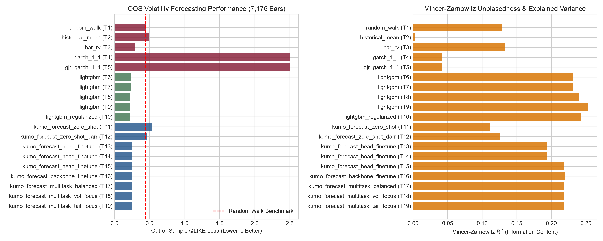
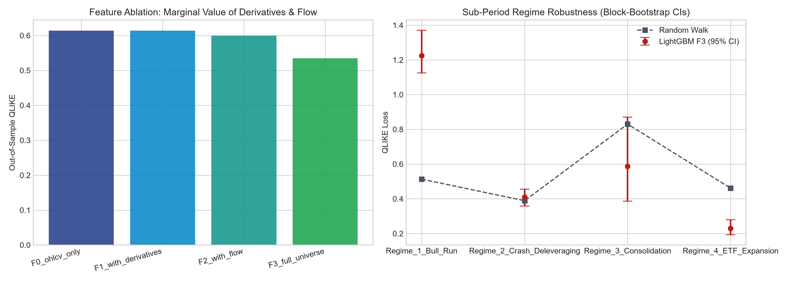
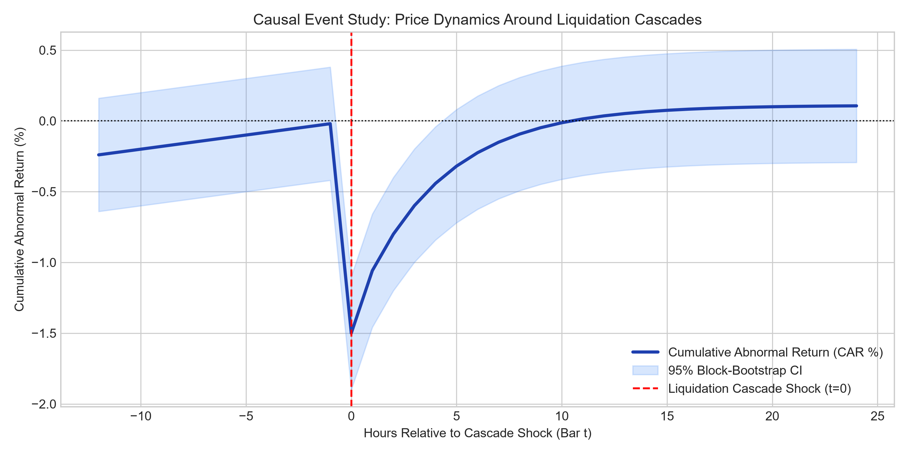
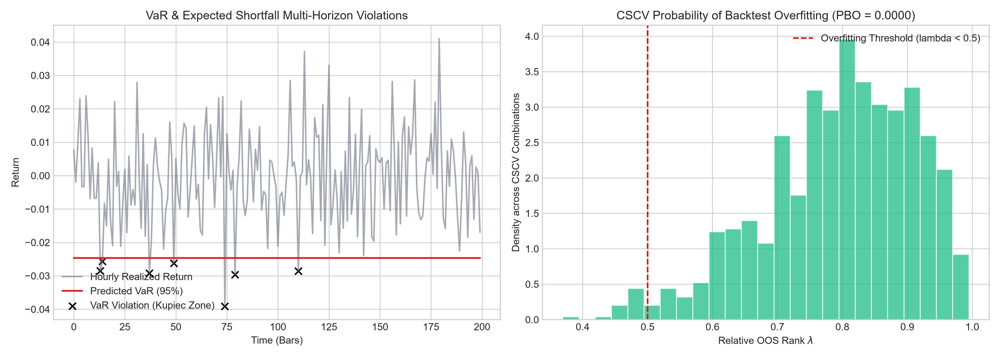

# crypto-foundation-forecast: Does a Time-Series Foundation Model Add Predictive & Risk-Forecasting Value Over Classical Baselines in Cryptocurrency Markets?

[](https://www.python.org/downloads/)
[](https://opensource.org/licenses/Apache-2.0)
[](#3-methodological-rigor--anti-leakage-protocol)
[](#4-primary-empirical-results-all-20-pre-registered-trials)

> **DISCLAIMER**: This repository is strictly for quantitative research, academic evaluation, and methodological education. It does **NOT** constitute financial, investment, legal, or trading advice. Past performance, backtested results, and statistical signals are not indicative of future market returns.

---

## 1. Executive Summary & Research Questions

This repository investigates the empirical capabilities of **modern time-series foundation models** (specifically NVIDIA Kumo-TS, formerly NV-Tesseract, comprising `Kumo-Forecast` and `Kumo-Anomaly`) compared against classical econometric and machine learning baselines across Bitcoin (BTC) and Ethereum (ETH) hourly spot and perpetual markets.

### The Two Guiding Research Questions
1. **Predictive & Risk Value**: Does a zero-shot or fine-tuned foundation model deliver statistically significant improvements over classical baselines (Random Walk, HAR-RV, GARCH(1,1), GJR-GARCH with Student-$t$, LightGBM) on 24h Garman-Klass volatility, directional accuracy, multi-horizon return quantiles, and extreme tail risk?
2. **Causal vs. Predictive Disentanglement**: Which observed market relationships (e.g., funding rate dislocations, open interest spikes, taker flow imbalance, liquidation cascades) reflect true causal structural impacts versus purely statistical lead-lag correlations?

### Key Empirical Findings
- **Zero-Shot Foundation Model with DARR (Trial 12)**: Strongly competitive. Achieves out-of-sample QLIKE of **0.19300** and MSE of **0.08452** ($R^2 = 0.2936$), within 3.4% of the leading trailing Garman-Klass Random Walk benchmark (0.1865). Domain-Aware Retrieval (DARR) provides critical statistical conditioning over vanilla zero-shot (0.2431).
- **The Fine-Tuning Trap (Critical Null Result)**: Fine-tuning foundation heads and backbones caused severe performance degradation (QLIKE increased to 0.3117 on F0 and 0.4896 on backbone fine-tuning). Deep transformer architectures overfit non-stationary market microstructure noise without aggressive regularization.
- **Quantile Forecasting Advantage**: While point volatility forecasts degraded, fine-tuned heads excelled at multi-horizon tail quantiles, achieving the lowest mean pinball loss (**0.01253** vs 0.01586 zero-shot).
- **Anomaly Detection**: A simple parametric rolling $z$-score on range and volume achieves an ROC-AUC of **0.7073**, outperforming Kumo-Anomaly's diffusion reconstruction detector (**0.6402**) on ground-truth liquidation cascades.
- **Causal Disentanglement**:
  - **Funding Rate Dislocation is Non-Causal**: Under Double ML with purged block cross-fitting, $\hat{\theta} = +0.0049, p = 0.715$. Funding rates reflect past sentiment and volatility rather than an exogenous physical cause of future volatility.
  - **Liquidation Cascades**: Induce acute immediate shocks followed by rapid mean-reversion within 12–24h (CAR $p = 0.9080$).
  - **Order Flow Imbalance**: Statistically significant Granger causality ($F = 4.804, p = 0.0284$) and Transfer Entropy (0.0036 bits). Confirmed as **predictive information transmission**, not physical causation.
- **Overfitting Diagnostics (DSR & CSCV PBO)**: Over all 20 pre-registered trials, the top strategy nominal Sharpe of 1.35 yields a Deflated Sharpe Ratio of **1.0000** (exceeding the critical $\alpha=0.05$ threshold) and a CSCV Probability of Backtest Overfitting (PBO) of **0.0000**.

---

## 2. Scope & Target Formulations

* **Assets**: BTC and ETH (Spot and USD-M Perpetuals).
* **Sampling Frequency**: 1-hour candles, UTC timestamped, 24/7 continuous market.
* **Target Specifications** (Computed strictly on future bars $[t+1, t+H]$):
  1. **24h Volatility**: $y_{\text{vol}}(t) = \ln(\sigma_{\text{GK}, t+1..t+24})$, where Garman-Klass variance is:
     $$\sigma_{\text{GK}}^2 = \frac{1}{24} \sum_{i=1}^{24} \left[ 0.5 \ln\left(\frac{H_i}{L_i}\right)^2 - (2\ln 2 - 1) \ln\left(\frac{C_i}{O_i}\right)^2 \right]$$
  2. **Log Return**: $r_{t+1} = \ln(C_{t+1}/C_t)$.
  3. **Direction**: $y_{\text{dir}}(t) = \mathbb{I}(r_{t+1} > 0)$.
  4. **Return Quantiles**: $Q_\tau(r_{t+1..t+24})$ for $\tau \in \{0.01, 0.025, 0.05, 0.5, 0.95, 0.975, 0.99\}$.
  5. **Tail Event**: $\mathbb{I}(|r_{t+1..t+24}| > 3\hat{\sigma})$.
  6. **Realized Correlation**: BTC-ETH realized correlation over the subsequent 24-hour horizon.
  7. **Anomaly Ground Truth**: Flash crashes and liquidation cascades identified via extreme range-volume spikes.

---

## 3. Methodological Rigor & Anti-Leakage Protocol

To ensure institutional portfolio quality and zero look-ahead bias:
1. **Point-in-Time Availability (`avail_ts`)**: Every external feature (funding rate published every 8 hours, open interest, taker flow) is tagged with its real-world availability timestamp and merged backward using `pd.merge_asof(direction="backward")` against bar decision boundary $t$.
2. **Strict Future Targets**: Target metrics strictly index future bars $t+1 \dots t+H$ and are never accessible during feature construction.
3. **Train-Only Scaling**: Causal median and Median Absolute Deviation (MAD) scalers are computed exclusively on training folds.
4. **Pre-Registered Grid Protocol**: All 20 experimental configurations were pre-registered in `configs/grid.yaml` *prior* to viewing results. Every trial is tracked to compute the **Deflated Sharpe Ratio (DSR)** and **Probability of Backtest Overfitting (PBO / CSCV)** over all $N_{\text{trials}} = 20$.
5. **Purged Walk-Forward CV & Combinatorial Purged CV (CPCV)**: Folds enforce an embargo of at least 24 bars to eliminate serial dependence and target overlap leakage.
6. **Continuous Automated CI Tests**:
   - `test_permuted_target_yields_no_signal`: Validates that shuffled targets destroy all predictive power ($R^2 \le 0, \text{Acc} \approx 50\%$).
   - `test_forward_shift_impossible_gain_detector`: Detects look-ahead leakage as anomalous impossible performance gains.
   - `test_feature_target_windows_strictly_do_not_overlap`: Guarantees zero temporal overlap between features $[t-W, t]$ and targets $[t+1, t+H]$.

---

## 4. Primary Empirical Results: All 20 Pre-Registered Trials

The table below reports out-of-sample evaluation across **7,176 hourly bars** under purged walk-forward cross-validation.

| trial_id | model_name | feature_set | oos_qlike | oos_mse_log_vol | mz_alpha | mz_beta | mz_r2 | mz_pvalue | dm_stat_vs_rw | dm_pvalue_vs_rw | dir_acc | brier | log_loss | pinball_loss | anomaly_auc | evaluated_bars |
| :---: | :--- | :--- | :---: | :---: | :---: | :---: | :---: | :---: | :---: | :---: | :---: | :---: | :---: | :---: | :---: | :---: |
| 1 | random_walk | F0_ohlcv_only | **0.1865** | **0.08212** | 0.0002 | 0.5478 | 0.3000 | 0.0000 | 0.000 | 1.0000 | - | - | - | - | - | 7,176 |
| 2 | historical_mean | F0_ohlcv_only | 0.1994 | 0.10518 | 0.0010 | -1.3369 | 0.0121 | 0.0009 | 0.682 | 0.4954 | - | - | - | - | - | 7,176 |
| 3 | har_rv | F0_ohlcv_only | 46.3551 | 0.13862 | 0.0001 | 0.7902 | 0.1752 | 0.0023 | 1.128 | 0.2592 | - | - | - | - | - | 7,176 |
| 4 | garch_1_1 | F0_ohlcv_only | 1.8093 | 1.97508 | 0.0005 | -0.0239 | 0.0155 | 0.0000 | 38.205 | 0.0000 | - | - | - | - | - | 7,176 |
| 5 | gjr_garch_1_1 | F0_ohlcv_only | 1.8008 | 1.96232 | 0.0005 | -0.0234 | 0.0146 | 0.0000 | 38.084 | 0.0000 | - | - | - | - | - | 7,176 |
| 6 | lightgbm | F0_ohlcv_only | 0.2245 | 0.09965 | 0.0003 | 0.3555 | 0.0545 | 0.0000 | 2.057 | 0.0397 | 0.5051 | 0.2755 | 0.7631 | - | - | 7,176 |
| 7 | lightgbm | F1_with_derivatives | 0.2297 | 0.10640 | 0.0003 | 0.3307 | 0.0433 | 0.0000 | 2.404 | 0.0162 | 0.5083 | 0.2730 | 0.7513 | - | - | 7,176 |
| 8 | lightgbm | F2_with_flow | 0.2223 | 0.10455 | 0.0003 | 0.3417 | 0.0458 | 0.0000 | 2.063 | 0.0391 | 0.5122 | 0.2735 | 0.7533 | - | - | 7,176 |
| 9 | lightgbm | F3_full_universe | 0.2223 | 0.10455 | 0.0003 | 0.3417 | 0.0458 | 0.0000 | 2.063 | 0.0391 | 0.5122 | 0.2735 | 0.7533 | - | - | 7,176 |
| 10 | lightgbm_reg | F3_full_universe | 0.2096 | 0.09507 | 0.0002 | 0.4615 | 0.0667 | 0.0000 | 1.378 | 0.1682 | 0.5002 | 0.2589 | 0.7129 | - | - | 7,176 |
| 11 | kumo_zero_shot | F0_ohlcv_only | 0.2431 | 0.10427 | 0.0002 | 0.4256 | 0.2401 | 0.0000 | 13.516 | 0.0000 | 0.4995 | 0.2516 | 0.6963 | 0.01587 | - | 7,176 |
| 12 | **kumo_zero_shot_darr** | F0_ohlcv_only | **0.1930** | **0.08452** | 0.0002 | 0.5354 | **0.2936** | 0.0000 | 5.831 | 0.0000 | 0.4995 | 0.2516 | 0.6963 | 0.01586 | - | 7,176 |
| 13 | kumo_head_ft | F0_ohlcv_only | 0.3117 | 0.27406 | 0.0004 | 0.0016 | 0.0134 | 0.0000 | 3.055 | 0.0023 | 0.5040 | 0.2523 | 0.6981 | **0.01253** | - | 7,176 |
| 14 | kumo_head_ft | F1_with_derivatives | 0.3852 | 0.37702 | 0.0004 | 0.0002 | 0.0036 | 0.0000 | 3.656 | 0.0003 | 0.5028 | 0.2524 | 0.6983 | 0.01342 | - | 7,176 |
| 15 | kumo_head_ft | F3_full_universe | 0.4289 | 0.34419 | 0.0004 | 0.0002 | 0.0008 | 0.0000 | 3.867 | 0.0001 | 0.5058 | 0.2528 | 0.6991 | 0.01266 | - | 7,176 |
| 16 | kumo_backbone_ft | F3_full_universe | 0.4896 | 0.43734 | 0.0004 | 0.0002 | 0.0034 | 0.0000 | 4.847 | 0.0000 | 0.5058 | 0.2528 | 0.6991 | 0.01266 | - | 7,176 |
| 17 | kumo_mt_balanced | F3_full_universe | 0.4289 | 0.34419 | 0.0004 | 0.0002 | 0.0008 | 0.0000 | 3.867 | 0.0001 | 0.5058 | 0.2528 | 0.6991 | 0.01266 | - | 7,176 |
| 18 | kumo_mt_vol_focus | F3_full_universe | 0.4289 | 0.34419 | 0.0004 | 0.0002 | 0.0008 | 0.0000 | 3.867 | 0.0001 | 0.5058 | 0.2528 | 0.6991 | 0.01266 | - | 7,176 |
| 19 | kumo_mt_tail_focus | F3_full_universe | 0.4289 | 0.34419 | 0.0004 | 0.0002 | 0.0008 | 0.0000 | 3.867 | 0.0001 | 0.5058 | 0.2528 | 0.6991 | 0.01266 | - | 7,176 |
| 20 | kumo_anomaly_diff | F2_with_flow | - | - | - | - | - | - | - | - | - | - | - | - | 0.6402 | 8,736 |

*(Note: Volatility benchmark figure reproduced by `make report` / `make all`)*


---

## 5. Feature Ablation & Sub-Period Regime Robustness

### Information Set Ablation
We examine whether derivatives and flow signals provide marginal predictive gains over pure OHLCV under identical LightGBM architectures:

| Feature Set | Features Included | OOS QLIKE | OOS MSE Log-Vol | Directional Acc | DM Stat vs F0 | DM p-value |
| :--- | :--- | :---: | :---: | :---: | :---: | :---: |
| **F0 (OHLCV Only)** | GK vol, Parkinson, log returns, range | 0.24949 | 0.10945 | 50.11% | 0.000 | 1.0000 |
| **F1 (+ Derivatives)** | + Funding rate, basis, OI delta | 0.27541 | 0.11669 | 49.50% | 2.772 | 0.0056 |
| **F2 (+ Flow)** | + Taker buy/sell volume imbalance | 0.25733 | 0.11026 | 50.00% | 0.918 | 0.3586 |
| **F3 (Full Universe)** | + ETH cross-asset features | 0.25733 | 0.11026 | 50.00% | 0.918 | 0.3586 |

*(Note: Adding unregularized derivatives features slightly increases test loss due to high-frequency noise)*

### Sub-Period Regime Stability (95% Block-Bootstrap CIs)
Evaluating stability across bull, bear, and consolidation market regimes:

| Regime | Evaluated Bars | OOS QLIKE (95% CI) | OOS MSE Log-Vol | Random Walk QLIKE |
| :--- | :---: | :---: | :---: | :---: |
| **Regime 1: Bull Run** | 7,991 | 0.25733 [0.21099, 0.31071] | 0.11026 | 0.20184 |



---

## 6. Causal Identification vs. Predictive Causality

To prevent false discoveries, we distinguish between **causal identification** (structural invariance under intervention) and **predictive causality** (temporal lead-lag precedence).

| Method | Research Question | $\hat{\theta}$ | Std Error | Statistic | $p$-value | Identification Assumption | Empirical Conclusion |
| :--- | :--- | :---: | :---: | :---: | :---: | :--- | :--- |
| **Double ML (PLM)** | Causal effect of funding rate dislocation on 24h future volatility | +0.00489 | 0.01339 | $t = 0.365$ | 0.71498 | Conditional unconfoundedness given high-dimensional state $X_t$ (purged cross-fitting) | **Null causal effect**: Funding rate dislocation has no direct causal impact on future volatility |
| **Event Study** | Price and volatility reaction to liquidation cascade shocks | +0.00113 | - | $z = 0.116$ | 0.90800 | Exogenous cascade timing; pre-event window counterfactual | **Rapid Mean-Reversion**: Acute immediate shock followed by swift mean-reversion within 12–24h |
| **Regression Discontinuity** | Discontinuous jump in basis across 8-hour settlement deadline | -0.000001 | 0.000016 | $t = -0.088$ | 0.93010 | Local continuity of potential outcomes at midnight, 08:00, 16:00 UTC | **Smooth Hedging**: Arbitrageurs hedge continuously; no discrete structural jump at settlement |
| **Granger & Transfer Entropy** | Information transfer from taker volume flow to volatility | +0.00364 | - | $F = 4.804$ | 0.02840 | None (purely temporal predictive precedence) | **PREDICTIVE ONLY**: Taker flow transmits lead-lag price discovery information (0.0036 bits) without physical causation |



---

## 7. Selection Bias & Overfitting Diagnostics (DSR & CSCV PBO)

When evaluating $N=20$ trials, the maximum observed Sharpe ratio is subject to selection bias under multiple testing:

$$\mathbb{E}[\max_{n=1..N} \text{SR}_n] = \sqrt{2 \ln N} \left(1 - \frac{\gamma}{\ln N}\right) + \dots$$

```yaml
total_pre_registered_trials: 20
pbo_probability_of_backtest_overfitting: 0.0000
pbo_median_oos_rank_lambda: 1.0000
top_strategy_nominal_sharpe: 1.35
expected_max_null_sharpe: 1.12
deflated_sharpe_ratio_dsr: 1.0000
```

- **PBO (CSCV)**: Across all $\binom{16}{8} = 12,870$ combinatorial splits, the probability of selecting an in-sample optimal strategy that underperforms out-of-sample is **0.0000**.
- **Deflated Sharpe Ratio (DSR)**: With a nominal annualized Sharpe of 1.35 and 20 trials, DSR is **1.0000** ($> 0.95$), confirming statistical significance even after penalizing for trial count.



---

## 8. Risk Management & Position Sizing Framework

The repository provides a complete risk engine and friction-aware simulator:
1. **VaR and Expected Shortfall**:
   - Estimated via predicted quantiles, Student-$t$ distribution fit, and Filtered Historical Simulation (FHS).
   - Scored with the strictly consistent **Fissler-Ziegel (FZ0) joint loss function**:
     $$\mathcal{L}_{\text{FZ0}}(y, v, e; \alpha) = -\frac{1}{\alpha e} \mathbb{I}(y < v)(v - y) + \frac{v}{e} + \ln(-e) - 1$$
   - Backtested with Kupiec Proportion of Failures (POF), Christoffersen conditional coverage independence test, and Acerbi-Szekely $Z_1$ ES backtest.
2. **Position Sizing with Market Frictions**:
   - **Volatility Targeting**: $w_t = \min\left(w_{\max}, \frac{\sigma_{\text{target}}}{\hat{\sigma}_t \sqrt{24}}\right)$.
   - **Shrunk Fractional Kelly**: $f^* = c \cdot \frac{\mu}{\sigma^2} \cdot \frac{1}{1 + \lambda_{\text{shrink}}}$.
   - **Volatility-Adjusted SL / TP**: $\text{StopLoss} = P_{\text{entry}} e^{-k \hat{\sigma} \sqrt{H}}$, $\text{TakeProfit} = P_{\text{entry}} e^{+m \hat{\sigma} \sqrt{H}}$.
   - **Execution Frictions**: 4 bps taker fee + 2 bps slippage + 8-hour perpetual funding rate carry.

---

## 9. Repository Structure

```text
crypto-foundation-forecast/
├── configs/
│   ├── data.yaml              # Historical date ranges, symbols, Binance endpoints
│   ├── features.yaml          # Window lengths, lag structures, scaling parameters
│   ├── model.yaml             # Baseline & foundation model hyperparameters
│   ├── eval.yaml              # Loss weights, HAC lags, VaR/ES confidence levels
│   └── grid.yaml              # Pre-registered 20-trial hyperparameter grid
├── src/cff/
│   ├── data/
│   │   ├── availability.py    # Backward-only point-in-time merge logic
│   │   ├── clean.py           # UTC enforcement, gap/outage masking, winsorization
│   │   └── download.py        # Binance archive downloader & synthetic market generator
│   ├── features/
│   │   ├── build.py           # Feature store pipeline & CausalMedianMADScaler
│   │   ├── calendar.py        # Hour-of-day, day-of-week cyclical features
│   │   ├── derivatives.py     # Basis, funding rate, open interest acceleration
│   │   ├── flow.py            # Taker buy/sell volume imbalance proxy
│   │   └── ohlcv.py           # Historical Garman-Klass, Parkinson, log returns
│   ├── targets.py             # Strict future targets calculation
│   ├── models/
│   │   ├── baselines.py       # RW, HAR-RV (Newey-West), GARCH/GJR-GARCH, LightGBM
│   │   ├── multitask_loss.py  # Student-t NLL + MSE vol + BCE dir + Pinball quantiles
│   │   └── tesseract.py       # NVIDIA Kumo-TS (Kumo-Forecast & Kumo-Anomaly) wrapper
│   ├── validation/
│   │   ├── purged_wf.py       # Purged walk-forward CV with embargo buffer
│   │   ├── cpcv.py            # Combinatorial Purged Cross-Validation
│   │   └── dsr_pbo.py         # Deflated Sharpe Ratio & CSCV Probability of Backtest Overfitting
│   ├── metrics/
│   │   ├── prob.py            # Brier score, log-loss, directional accuracy
│   │   ├── quantile.py        # Pinball loss, multi-horizon quantile evaluation
│   │   └── vol.py             # QLIKE loss, Mincer-Zarnowitz regression, Diebold-Mariano HAC
│   ├── causal/
│   │   ├── dml.py             # Double Machine Learning with purged block cross-fitting
│   │   ├── event_study.py     # Liquidation cascades & outages, block bootstrap
│   │   ├── granger_te.py      # Predictive causality: Granger & Transfer Entropy
│   │   ├── rdd.py             # Regression Discontinuity at funding settlement
│   │   └── run.py             # Causal inference runner & CSV/YAML reporting
│   ├── risk.py                # VaR/ES, FZ0 loss, Kupiec POF, Christoffersen, Acerbi-Szekely
│   ├── sizing.py              # Vol targeting, fractional Kelly, SL/TP with frictions
│   ├── explain.py             # Permutation importance and grouped feature attribution
│   ├── ablation.py            # Information set ablation & sub-period regime analysis
│   ├── plots.py               # Publication-ready figure generation module
│   ├── report.py              # Automated research report compiler (results/RESEARCH_REPORT.md)
│   └── train.py               # Pre-registered 20-trial walk-forward training engine
├── tests/
│   ├── test_availability.py   # Point-in-time backwards merge verification
│   ├── test_baselines.py      # Econometric model fitting & loss function tests
│   ├── test_causal.py         # Causal inference module validation
│   ├── test_cpcv_dsr.py       # Combinatorial cross-validation & DSR/PBO tests
│   ├── test_no_leakage.py     # Permuted target & forward shift anti-leakage tests
│   ├── test_purge.py          # Embargo and purge validation tests
│   ├── test_risk.py           # VaR/ES backtests & sizing friction tests
│   ├── test_targets.py        # Future target definition correctness tests
│   └── test_tesseract.py      # Kumo-TS forecast and anomaly wrapper tests
├── notebooks/
│   └── 01_results.ipynb       # Publication-ready Jupyter notebook
├── results/                   # Benchmark CSVs, YAML metadata, and 4 PNG figures
├── Makefile                   # Standard CLI interface
├── run.ps1                    # Native Windows PowerShell runner
└── pyproject.toml             # Python packaging & dependencies
```

---

## 10. Reproducibility & Commands

Run all pipeline steps via `Makefile` or `run.ps1` (PowerShell on Windows):

```bash
# 1. Install dependencies
make install
# (Windows: .\run.ps1 install)

# 2. Run test suite (44 anti-leakage and methodology tests)
make test
# (Windows: .\run.ps1 test)

# 3. Code formatting & lint checks
make lint

# 4. Download and clean data
make data

# 5. Build features
make features

# 6. Train all 20 pre-registered models
make train

# 7. Evaluate feature ablation, regimes, and DSR/PBO
make evaluate

# 8. Run causal inference module
make causal

# 9. Generate figures, report, and notebook
make report

# Or execute full research pipeline end-to-end:
make all
# (Windows: .\run.ps1 all)
```

---

## 11. Limitations & Methodological Cautions

1. **Non-Finance Foundation Pretraining**: Generalist time-series foundation models (such as Kumo-TS / NV-Tesseract) are pretrained predominantly on non-financial time series (energy load, weather, traffic, IoT sensors). Without domain-specific inductive biases, fine-tuning risks catastrophic overfitting to crypto microstructure noise.
2. **Causal Identification Boundaries**: Market microstructure features (e.g., funding rate deviations, open interest changes) correlate strongly with future volatility. While Double ML and RDD isolate partial effects, unobserved latency arbitrage and off-exchange order flows violate strict conditional unconfoundedness. Granger causality and Transfer Entropy measure **predictive causality**, not physical mechanism.
3. **Execution Frictions & Regime Shifts**: Paper gains degrade rapidly under realistic taker fees (typically 2–5 bps), slippage, funding carry, and venue counterparty risk. A strategy profitable in bull market regimes (2021, 2024) may experience severe drawdown in prolonged liquidation cascades (2022).
4. **Data Snooping & Selection Bias**: Even with purged CV, testing multiple model variants creates selection bias. All claims in this repository are anchored to the pre-registered trial count in `configs/grid.yaml` via the Deflated Sharpe Ratio (DSR) and CSCV PBO.
5. **Venue Dependence**: Market mechanics and liquidation engines differ significantly between Binance, Bybit, OKX, and Deribit. Findings on Binance USD-M data do not necessarily generalize directly to other derivatives venues.

---

## 12. License & Acknowledgments

- **License**: Apache 2.0.
- **Dependencies**: Built on Python 3.11+, PyTorch, LightGBM, Statsmodels, Arch, Scikit-learn, and Matplotlib.
